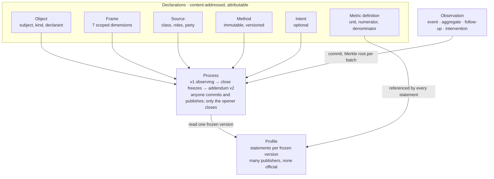

# GEOF concept model

The Generative Engine Optimization Framework (GEOF) records how a generative engine represented an object, how that was measured, and what independent parties may say about it. This page is the one-picture summary of the record types and the two worked cases that exercise them. The normative text is `ERCS/erc-8501.md`.

## One observation model

```text
(Subject, Engine, Trigger)  ->  Representation  ->  Reception
```

- **Representation** is what the engine did with the object in one run: `OMITTED`, `RETRIEVED_NOT_USED`, `MENTIONED`, `CITED`, `RECOMMENDED`, `INVOKED` (with the `actor` that performed it).
- **Reception** is what the recipient did afterwards, recorded as follow-up observations with a stated link basis.
- **Fidelity** is a third, separate question: did the representation stay faithful to the source, and are the source's own claims supported.

Three different kinds of intent are kept apart: the recipient's *query intent* (an Event field), an *intervention* by whoever changed the object (an Observation kind), and the *dissemination intent* of the party that wanted the object disseminated (an Intent record).

## Record types



| Record | What it is | Who writes it |
| --- | --- | --- |
| Object | engine-independent subject: content, entity, offer, agent, skill, task, registry, claim | anyone; a declaration confers no control |
| Frame | observation boundary: time, engines, queries, locales, objects, observers, repetition; two granularities; three clocks | the observer who opens the Process |
| Source | a data source with class, roles (engine-input / observation / evaluation), party and verifiability | whoever used it |
| Method | immutable, versioned method descriptor | whoever applied it |
| Intent | dissemination intent, ex-ante or ex-post | the disseminating party |
| Metric definition | what a reading means; no preferred direction | anyone; third parties under `geof:x/<publisher>/…` |
| Observation | event, aggregate, follow-up or intervention | any observer |
| Profile | statements against one frozen Process version | any publisher |

## Five value states

`ABSENT` (checked, none) · `UNOBSERVED` (no material) · `NOT_APPLICABLE` (no meaning here) · `UNDETERMINABLE` (material, no determination) · or a value. `UNOBSERVED` is never zero.

## Ten families

`exposure` · `presentation` · `reception` · `fidelity` · `seo` · `access` · `dynamics` · `economics` · `attainment` · `attribution`.
`attainment` and `attribution` statements must cite an Intent. `fidelity` statements must name a reference set, a comparator and a proposition.

## Two cases, one framework

| | Case A — web correction notice | Case B — agentic skill |
| --- | --- | --- |
| Object | a corrective claim and the page carrying it | a skill token with a value-registry record |
| Intent | public searchers should become aware and understand condition Z | three named agents should invoke and settle |
| Frame | 3 engines × 40 prompts × 12 runs, en-US, third-party panel | two discovery layers, no queries, first-party logs + chain |
| Exposure | answer-inclusion 0.74 (1066/1440) | public retrieval 0.042 (9/212); targeted reach 1.0 (3/3) |
| Presentation | citation-rate 0.61; first-citation 0.31 of citing answers | recommendation `UNOBSERVED` (agents' ranking not visible) |
| Fidelity | claim-coverage of the key proposition 0.23 (245/1066) | relay-fidelity 1.0 (descriptor hash match, 11/11) |
| Reception | `UNOBSERVED` (no recipient source) | invocation incidence 1.0, intensity 2.33 calls/agent |
| Attainment | `UNOBSERVED` (needs recipient evidence) | 1.0 for `invoked`, 1.0 for `acted` |
| Attribution | not stated | `UNDETERMINABLE`, basis `declared` |
| Reading | wide, unfaithful, effect unknown | narrow, faithful, fully attained, contribution unproven |

Neither case receives a score. The full records are in `assets/erc-8501/examples/`.
